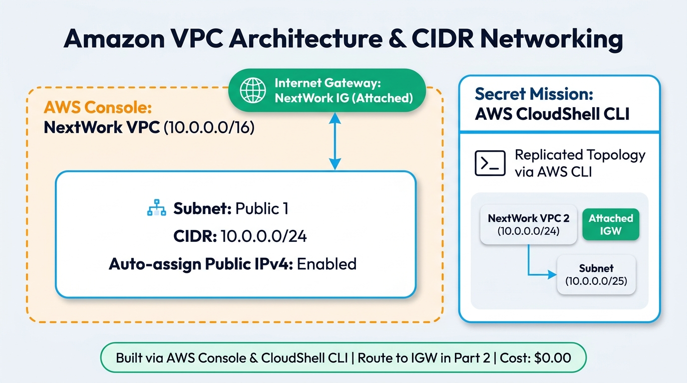
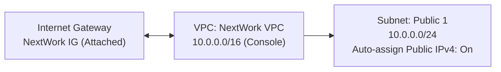

<div align="center">



# My First AWS VPC: Console & CLI


**Built an AWS Virtual Private Cloud, Subnet, and Internet Gateway using both the AWS Management Console and AWS CloudShell CLI.**

</div>

---

## 1. Architecture Overview



> [!IMPORTANT]
> **Key Design Decision:** Building the same VPC topology twice—first in the AWS Console (`NextWork VPC`) and then via AWS CLI in CloudShell (`NextWork VPC 2`)—validates both visual networking concepts and repeatable CLI provisioning. Note that `Public 1` only becomes truly public after adding a route to the Internet Gateway in the next project of the VPC series.

---

## 2. Problem & Solution

| Aspect | Detail |
| :--- | :--- |
| **Problem** | Default VPCs abstract away how IP ranges (`CIDR`), subnets, and internet gateways actually connect together. |
| **Solution** | Provisioned a custom VPC, subnet, and attached Internet Gateway manually in the AWS Console, then replicated the setup via AWS CloudShell CLI. |
| **Networking Scope** | Console: `NextWork VPC` (`10.0.0.0/16`) + `Public 1` (`10.0.0.0/24`) + `NextWork IG`; CLI: `NextWork VPC 2` (`10.0.0.0/24`) + `10.0.0.0/25` + attached IGW. |

---

## 3. Tech Stack
- **Cloud:** Amazon Web Services (VPC, Subnets, Internet Gateway)
- **Tools:** AWS Management Console, AWS CloudShell, AWS CLI
- **Documentation:** Git & GitHub

---

## 4. Implementation Steps (Summary)
1. **AWS Console Setup:** Created `NextWork VPC` (`10.0.0.0/16`), created subnet `Public 1` (`10.0.0.0/24`) with auto-assign public IPv4 enabled, and created & attached `NextWork IG`.
2. **Secret Mission (AWS CloudShell CLI):** Repeated the build using `aws ec2` commands to create `NextWork VPC 2` (`10.0.0.0/24`), a `10.0.0.0/25` subnet, and an attached Internet Gateway.
3. **Troubleshooting & Cost Guardrails:** Resolved CLI resource ID prefix and option spelling issues, and verified `$0` cost (no NAT Gateway, EC2, or standalone public IP created; budget alert active).

<details>
<summary><b>Click to expand AWS CLI commands & troubleshooting log</b></summary>

```bash
aws ec2 create-vpc --cidr-block 10.0.0.0/24 --query Vpc.VpcId --output text
aws ec2 create-tags --resources <vpc-id> --tags Key=Name,Value="NextWork VPC 2"
aws ec2 create-subnet --vpc-id <vpc-id> --cidr-block 10.0.0.0/25
aws ec2 create-internet-gateway --query InternetGateway.InternetGatewayId --output text
aws ec2 attach-internet-gateway --vpc-id <vpc-id> --internet-gateway-id <igw-id>
```

| Problem | Diagnosis | Solution |
| :--- | :--- | :--- |
| `InvalidVpcId.Malformed` and `InvalidInternetGatewayId.Malformed` | Copied IDs without their resource prefix (`vpc-`, `igw-`) | Used full IDs (e.g., `vpc-0d0cc075...`) |
| `create-tags` failed | Left placeholder `VPC-ID` in the command | Replaced placeholder with the actual VPC ID |
| `create-subnet` failed | Missing `--cidr-block` / typo `--cidr-bloc` | Fixed option name using `--help` |

</details>

---

## 5. Verification & Results
- **VPC Settings:** 
- **Subnet Created:** 
- **Internet Gateway Attached:** 
- **NextWork Project Page:** [View NextWork Project](https://nextwork.ai/hemaa/docs/7f907ac7-2473-5c15-a8be-edb36581cdba)

---

## 6. Key Engineering Takeaways
- **Subnet Naming vs. Routing:** Naming a subnet `Public 1` does not make it public on its own—an Internet Gateway attachment plus a route table entry (`0.0.0.0/0 -> igw`) is required.
- **CLI Precision:** Always pass full AWS resource prefixes (`vpc-`, `igw-`), replace placeholders, and verify flags with `--help`.
