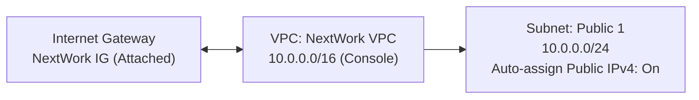

# Lab 01: Build a Virtual Private Cloud (Console & CLI)

- **NextWork Public Documentation:** [View Lab 01 on NextWork](https://nextwork.ai/hemaa/docs/7f907ac7-2473-5c15-a8be-edb36581cdba)
- **Cost:** `$0.00` (Free Tier / Zero-Spend Teardown verified)

---

## 1. Architecture Overview



> **Key Design Decision:** Building the same VPC topology twice—first in the AWS Console (`NextWork VPC`) and then via AWS CLI in CloudShell (`NextWork VPC 2`)—validates both visual networking concepts and repeatable CLI provisioning. Naming a subnet `Public 1` does not make it public until a Route Table directs `0.0.0.0/0` to the Internet Gateway (covered in Lab 02).

---

## 2. Implementation Summary
1. **AWS Console Setup:**
   - Created `NextWork VPC` (`10.0.0.0/16`).
   - Created subnet `Public 1` (`10.0.0.0/24`) with auto-assign public IPv4 enabled.
   - Created and attached `NextWork IG` to `NextWork VPC`.
2. **Secret Mission (AWS CloudShell CLI):**
   - Replicated the setup via `aws ec2` commands (`NextWork VPC 2` `10.0.0.0/24`, subnet `10.0.0.0/25`, attached IGW).

<details>
<summary><b>AWS CLI commands & troubleshooting log</b></summary>

```bash
aws ec2 create-vpc --cidr-block 10.0.0.0/24 --query Vpc.VpcId --output text
aws ec2 create-tags --resources <vpc-id> --tags Key=Name,Value="NextWork VPC 2"
aws ec2 create-subnet --vpc-id <vpc-id> --cidr-block 10.0.0.0/25
aws ec2 create-internet-gateway --query InternetGateway.InternetGatewayId --output text
aws ec2 attach-internet-gateway --vpc-id <vpc-id> --internet-gateway-id <igw-id>
```

| Problem | Diagnosis | Solution |
| :--- | :--- | :--- |
| `InvalidVpcId.Malformed` / `InvalidInternetGatewayId.Malformed` | Copied IDs without resource prefixes (`vpc-`, `igw-`) | Used full IDs |
| `create-tags` failed | Left placeholder `VPC-ID` in the command | Replaced placeholder with actual VPC ID |
| `create-subnet` failed | Typo `--cidr-bloc` | Fixed option name using `--help` |

</details>

---

## 3. Verification Screenshots
- **VPC Settings:** 
- **Subnet Created:** 
- **Internet Gateway Attached:** 
