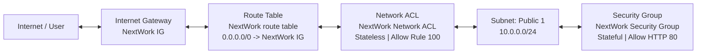

# Lab 02: VPC Traffic Flow and Security

- **NextWork Public Documentation:** [View Lab 02 on NextWork](https://nextwork.ai/hemaa/docs/fe5ed473-5874-57e1-a58f-d9b3d652330c)
- **AWS Region:** `us-east-2` (Main Lab) & `us-west-2` (Secret Mission)
- **Cost & Teardown:** `$0.00` — all resources in `us-west-2` deleted via AWS CLI and `NextWork VPC` deleted in `us-east-2` after completion.

---

## 1. Traffic Flow Architecture



---

## 2. Implementation Summary (AWS Console)
1. **Route Table (`NextWork route table`):**
   - Added route `0.0.0.0/0 -> NextWork IG` alongside `10.0.0.0/16 -> local`.
   - Explicitly associated `NextWork route table` with `Public 1` to make it a public subnet.
2. **Security Group (`NextWork Security Group`):**
   - Created inside `NextWork VPC` with Inbound rule allowing `HTTP` (TCP port `80`) from `0.0.0.0/0`.
   - Left default Outbound rule allowing all outbound traffic.
3. **Custom Network ACL (`NextWork Network ACL`):**
   - Created custom NACL (which denies all inbound and outbound traffic by default).
   - Added **Rule 100** (`All traffic`, `0.0.0.0/0`, `Allow`) for both Inbound and Outbound rules.
   - Associated `NextWork Network ACL` with `Public 1` (replacing the default NACL).

---

## 3. Secret Mission: Track VPC Resources Across Regions (AWS CloudShell + EC2 Global View)
Deployed 3 test resources in `us-west-2` via AWS CloudShell, verified them across all enabled regions in **EC2 Global View (Global search)**, and cleaned them up immediately via CLI:

```bash
# Create resources in us-west-2
aws ec2 create-vpc --cidr-block 10.0.0.0/24 --query "Vpc.VpcId" --output text --tag-specifications 'ResourceType=vpc,Tags=[{Key=Name,Value=new-region-VPC}]' --region us-west-2
aws ec2 create-internet-gateway --query "InternetGateway.InternetGatewayId" --output text --tag-specifications 'ResourceType=internet-gateway,Tags=[{Key=Name,Value="new-region-IG"}]' --region us-west-2
aws ec2 create-security-group --query "GroupId" --output text --description "New SG created to test creating an SG in another Region." --group-name new-region-sg --tag-specifications 'ResourceType=security-group,Tags=[{Key=Name,Value="new-region-sg"}]' --region us-west-2

# Clean up resources in us-west-2
aws ec2 delete-security-group --group-id <sg-id> --region us-west-2
aws ec2 delete-internet-gateway --internet-gateway-id <igw-id> --region us-west-2
aws ec2 delete-vpc --vpc-id <vpc-id> --region us-west-2
```

---

## 4. Key Engineering Takeaways
- **Route Table vs. Firewall:** An Internet Gateway attachment alone does not make a subnet public; the subnet's Route Table must route `0.0.0.0/0` to the IGW.
- **Security Group vs. Network ACL:**
  - **Security Groups** operate at the **resource/ENI level**, are **stateful**, and support **Allow rules only**.
  - **Network ACLs** operate at the **subnet level**, are **stateless** (requiring separate inbound and outbound rules), and support **both Allow and Deny rules**.
- **Default vs. Custom NACL:** Default NACLs allow all traffic (`Rule 100`), whereas newly created custom NACLs deny all traffic by default until allow rules are added.
